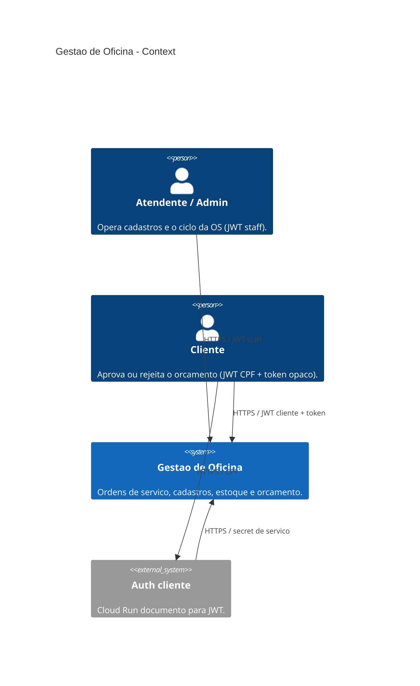
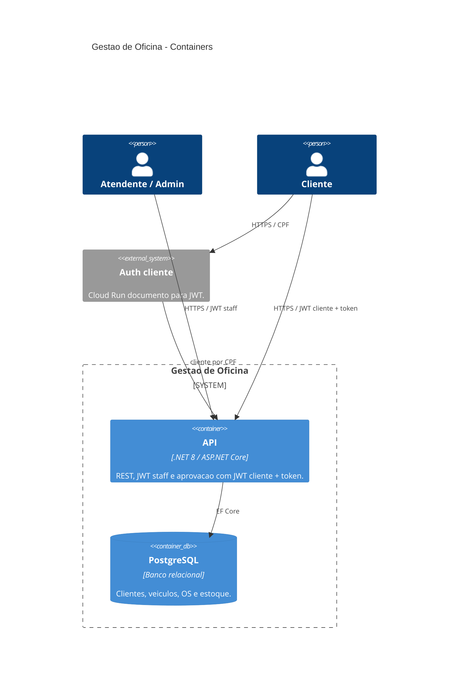
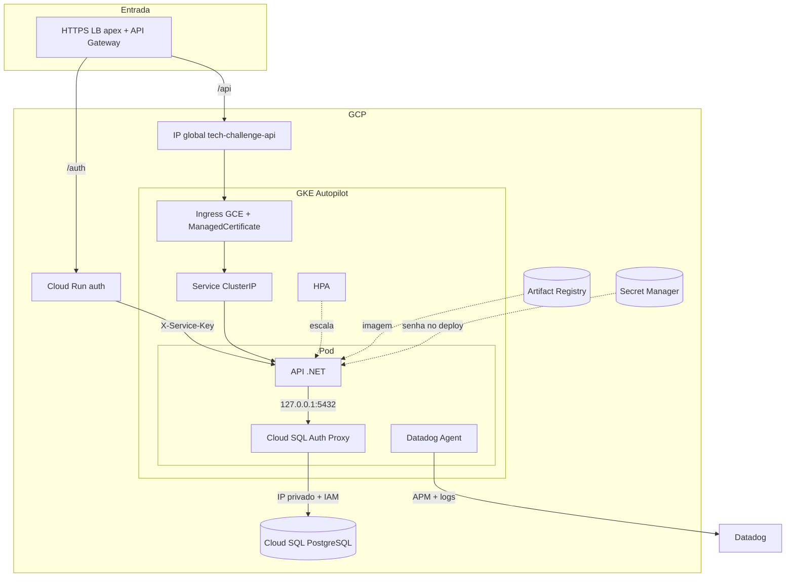
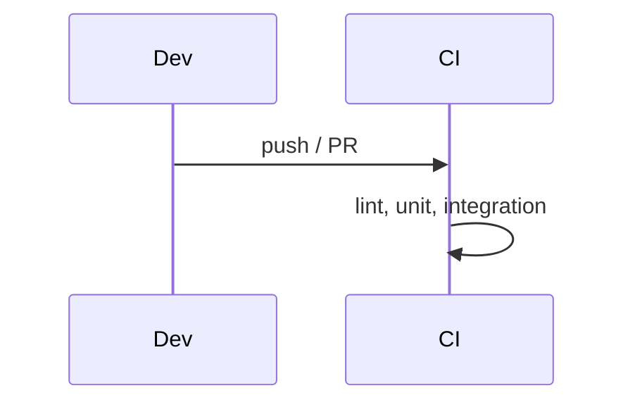

# Gestão de Oficina Mecânica

API .NET 8 para ordens de serviço, clientes, veículos, catálogo de serviços e estoque. Clean Architecture, PostgreSQL, Docker Compose para dev local e GKE Autopilot na GCP. Cluster e banco são provisionados pelos repos [`infra-k8s`](https://github.com/fiap-vcosta/infra-k8s) e [`infra-db`](https://github.com/fiap-vcosta/infra-db); os manifests e o deploy moram aqui.

## Arquitetura

### C4 — System Context



### C4 — Containers



Fluxo interno da API: `Controller` → `Use Case` → `Gateway` / `Domain` → `Presenter` → HTTP.

### Infraestrutura

Diagrama completo (Gateway, Cloud Run auth, stacks): README do [`infra-k8s`](https://github.com/fiap-vcosta/infra-k8s#componentes-nuvem). Visão focada no workload da API:



Modelo de dados (ER): [`docs/08_modelo-de-dados.md`](docs/08_modelo-de-dados.md). Sequência auth CPF: README do [`auth`](https://github.com/fiap-vcosta/auth).
### CI



---

## Como executar

### Docker Compose

```bash
cp .env.example .env
docker compose --profile app up -d --build
```

- API / Swagger / Health: http://localhost:8080 · `/swagger` · `/health`
- Login seed: `admin` / `admin`
- Variáveis: [`.env.example`](.env.example)

### SDK .NET

```bash
docker compose up -d
dotnet restore
dotnet ef database update --project src/Infrastructure --startup-project src/Api
dotnet run --project src/Api --launch-profile http
```

API local: http://localhost:5225

---

## Deploy na GCP

Manifests em [`k8s/`](k8s/): namespace, service account, ConfigMap, Deployment, Service `ClusterIP`, Ingress GCE, ManagedCertificate e HPA. O Deployment roda o **Cloud SQL Auth Proxy como sidecar nativo**, que autentica na instância por IAM (Workload Identity) e escuta em `127.0.0.1:5432` — a API só conhece `localhost`.

Entrada pública: **HTTPS** em `https://api.vcosta-fiap.online` (Ingress GCE + certificado gerenciado). O IP global `tech-challenge-api` e o record DNS `api` (Cloud DNS) vêm do [`infra-k8s`](https://github.com/fiap-vcosta/infra-k8s); os nameservers do domínio já apontam para o Google, então o A sobe/desce com o `tf-apply` / `tf-destroy`. Entrada oficial do cliente: `https://vcosta-fiap.online/api/...` (API Gateway no apex).

Não há Job de migration: a aplicação roda `db.Database.Migrate()` no start, e o sidecar nativo garante que o túnel esteja pronto antes disso.

Os workflows `build-push` e `deploy` deste monólito foram **removidos**. Não há CD automático nem `workflow_dispatch` de deploy neste repositório enquanto a API legada não for recortada em microsserviço. Quando o CD voltar, os callers usarão [`fiap-vcosta/actions`](https://github.com/fiap-vcosta/actions) (`build-push` / `deploy`).

Os manifests em [`k8s/`](k8s/) e a documentação de Ingress/HPA abaixo descrevem o shape ainda presente no repo; não dispare apply manual desses manifests na janela atual (a entrada pública já é Gateway API + API Gateway no `infra-k8s`).

Issuer/Audience de funcionário e de cliente ficam no ConfigMap (`tech-challenge-api` × `tech-challenge-cliente`) — dois emissores, dois materiais (RNF21). Localmente (Compose), use `JWT_FUNCIONARIO_*` e `JWT_CLIENTE_*` no `.env` — ver `.env.example`.

Evidência de HPA (quando houver deploy ativo):

```bash
./scripts/stress-hpa.sh https://api.vcosta-fiap.online
kubectl get hpa,pods -n tech-challenge
```

---

## Observabilidade (Datadog)

APM e logs da API na janela da demo (RNF22/RNF23; ADR [`docs/adrs/001-datadog-apm.md`](docs/adrs/001-datadog-apm.md)).

| Peça | Como |
|------|------|
| Logs | Serilog JSON no console + sink HTTP Datadog quando `DD_API_KEY` existe (intake derivado de `DD_SITE`) |
| APM | `Datadog.Trace.Bundle` + Agent **sidecar** no Deployment |
| Status OS | Log Info `OS {id} movida para o status {Status}` nos handlers (widgets de log no dashboard) |
| `/health` | Continua **público** (probes e smoke) |

Secrets/vars (org ou repo):

| Nome | Tipo | Uso |
|------|------|-----|
| `DD_API_KEY` | Secret | Agent sidecar + sink de logs |
| `DD_SITE` | Variable (opcional) | Default `datadoghq.com` se omitida |

Na demo, com o stack no ar e tráfego (Requestly):

1. Datadog → **APM** → serviço `api` (`env:prod`) — traces e latência.
2. **Logs** — JSON com `RequestId`; abra um log e siga para o trace (`dd.trace_id`).
3. Dashboard: importe [`docs/datadog/dashboard-api-demo.json`](docs/datadog/dashboard-api-demo.json) — passos em [`docs/datadog/README.md`](docs/datadog/README.md).
4. Monitor de erros / Synthetics em `/health` — mesmo doc.

Compose local: JSON no console sempre; envio ao Datadog só se `DD_API_KEY` estiver no `.env` (sem sidecar local por padrão).

---

## APIs principais

| Capacidade | Endpoint | Auth |
|------------|----------|------|
| Abrir OS (veículo + serviços + peças) | `POST /api/ordens-servico` | JWT Admin |
| Consultar OS | `GET /api/ordens-servico/{id}` | JWT Admin |
| Listar OS ativas | `GET /api/ordens-servico` | JWT Admin |
| Aprovar / rejeitar orçamento | `POST …/ordens-servico/aprovar?token=` · `…/rejeitar?token=` | JWT **cliente** + token opaco |
| Cliente por CPF (serviço) | `GET /api/system/clientes/por-documento/{documento}` | `X-Service-Key` |

Listagem exclui Finalizada, Entregue e Descartada; ordenação por status evolutivo e data. Aprovação reutiliza os mesmos use cases da API autenticada; o CPF do JWT deve ser o do dono da OS. Requisitos: [`docs/01_requisitos.md`](docs/01_requisitos.md). Auth cliente: repo [`auth`](https://github.com/fiap-vcosta/auth).

---

## Testes e CI/CD

```bash
dotnet test tests/UnitTests/UnitTests.csproj
dotnet test tests/IntegrationTests/IntegrationTests.csproj   # requer Docker
./run-tests-with-coverage.sh                                 # meta ≥ 80%
```

- Estratégia: [`docs/06_testes.md`](docs/06_testes.md)
- Collections HTTP: [`docs/07_api.md`](docs/07_api.md) (Swagger + Requestly; e2e Gateway em `12-gateway-cliente-aprovar`)
- CI: lint + unit + integration + Sonar via caller de [`fiap-vcosta/actions`](https://github.com/fiap-vcosta/actions) ([`ci.yml`](.github/workflows/ci.yml))
- CD: desativado neste monólito; volta com callers de `build-push` / `deploy` do mesmo repo `actions` no recorte em microsserviço

---

## Documentação

Índice: [`docs/README.md`](docs/README.md)

| Repo | Papel | Diagrama / doc-chave |
|------|--------|----------------------|
| [`infra-bootstrap`](https://github.com/fiap-vcosta/infra-bootstrap) | Rede, WIF, AR, zona DNS | Persistente |
| [`infra-db`](https://github.com/fiap-vcosta/infra-db) | Cloud SQL | ADRs de banco |
| [`infra-k8s`](https://github.com/fiap-vcosta/infra-k8s) | GKE + Gateway + Cloud Run auth | [Componentes](https://github.com/fiap-vcosta/infra-k8s#componentes-nuvem) |
| [`api`](https://github.com/fiap-vcosta/api) | App + manifests + Requestly | [ER](docs/08_modelo-de-dados.md) · C4 (acima) |
| [`auth`](https://github.com/fiap-vcosta/auth) | Imagem documento → JWT | Sequência no README |