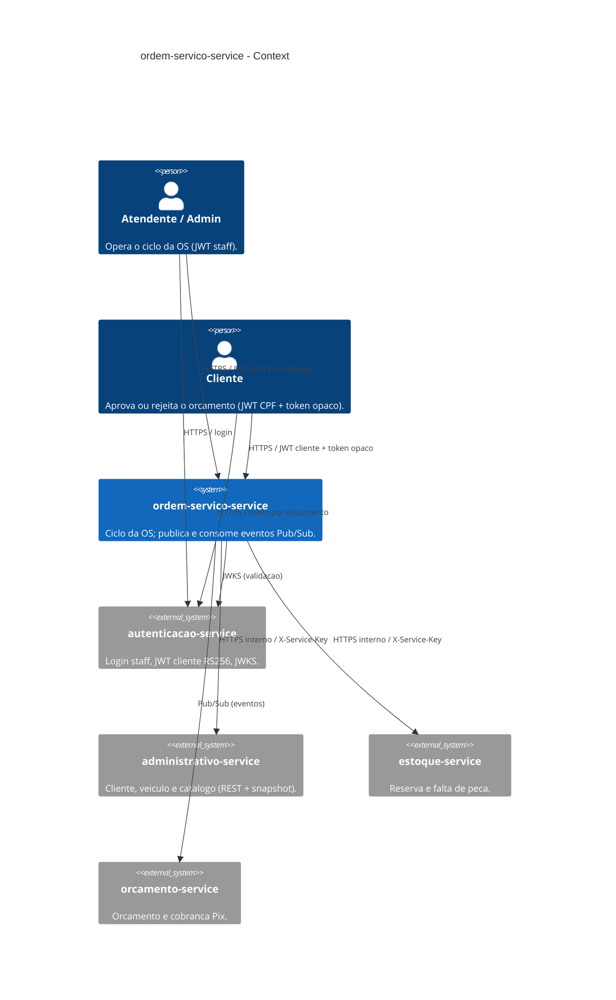
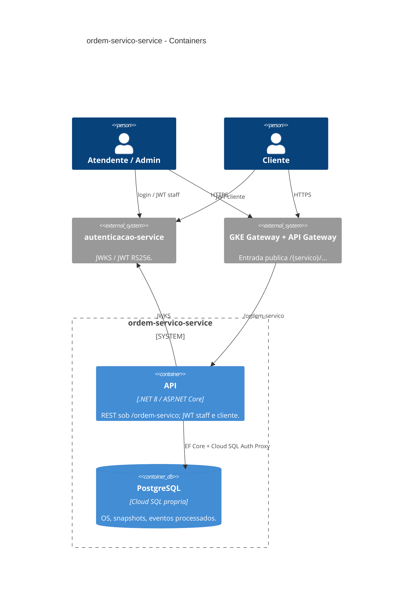
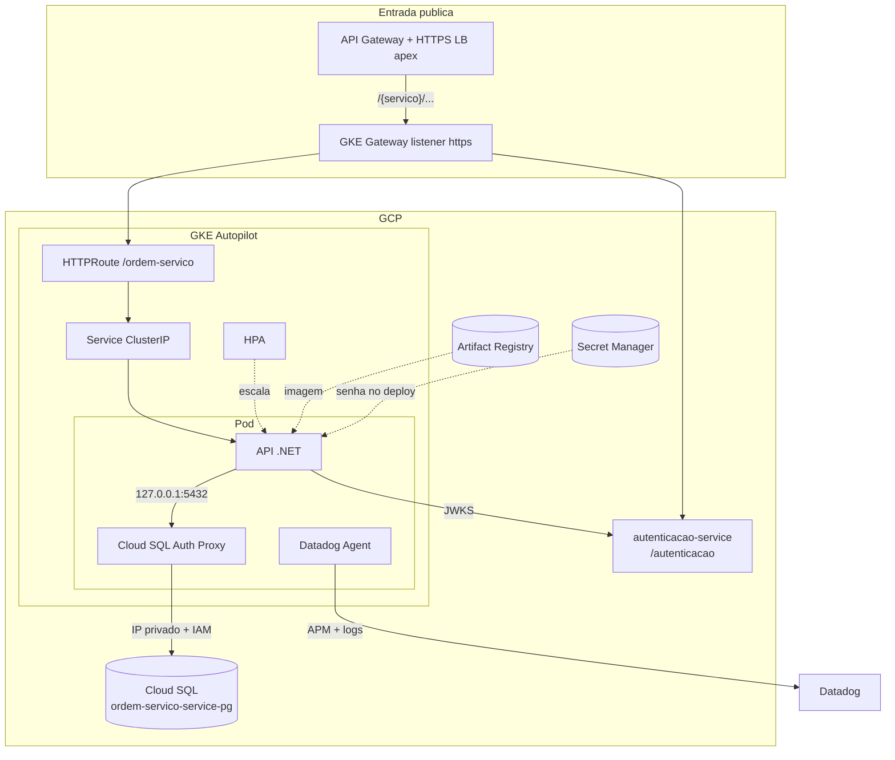
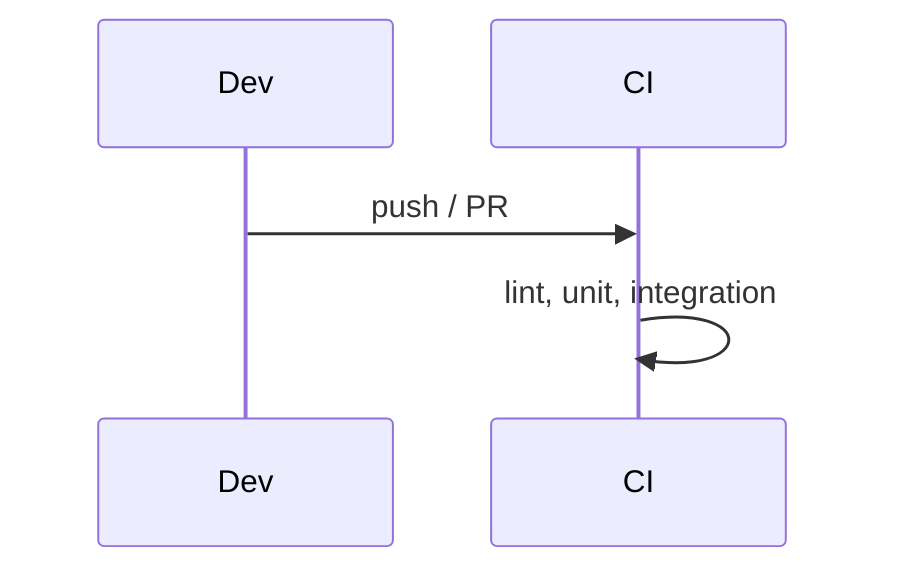

# ordem-servico-service

[](https://sonarcloud.io/summary/new_code?id=fiap-vcosta_ordem-servico-service)
[](https://sonarcloud.io/summary/new_code?id=fiap-vcosta_ordem-servico-service)
[](https://sonarcloud.io/summary/new_code?id=fiap-vcosta_ordem-servico-service)
[](https://sonarcloud.io/summary/new_code?id=fiap-vcosta_ordem-servico-service)
[](https://sonarcloud.io/summary/new_code?id=fiap-vcosta_ordem-servico-service)
[](https://sonarcloud.io/summary/new_code?id=fiap-vcosta_ordem-servico-service)

API .NET 8 de ordens de serviço (diagnóstico, aprovação, execução, pagamento). Clean Architecture, PostgreSQL na própria instância Cloud SQL, Docker Compose para dev local e GKE Autopilot na GCP. Org [fiap-vcosta](https://github.com/fiap-vcosta).

- Requisitos: [`docs/01_requisitos.md`](docs/01_requisitos.md) (paths atuais = sessão Outubro/2026)
- Domínio (linguagem + modelo): [`e2e` / docs/dominio/ordem-servico](https://github.com/fiap-vcosta/e2e/blob/main/docs/dominio/ordem-servico.md)
- Saga / arquitetura do sistema: [`e2e` / docs/saga.md](https://github.com/fiap-vcosta/e2e/blob/main/docs/saga.md), [`e2e` / docs/arquitetura.md](https://github.com/fiap-vcosta/e2e/blob/main/docs/arquitetura.md)
- Cloud SQL 1/serviço: [`e2e` ADR 001](https://github.com/fiap-vcosta/e2e/blob/main/docs/adrs/001-instancia-cloud-sql-por-servico.md)
- Deploy/demo manuais (custo): [`e2e` ADR 006](https://github.com/fiap-vcosta/e2e/blob/main/docs/adrs/006-deploy-demo-manuais-custo.md)
- Microsserviços / Saga: [`e2e` ADR 003](https://github.com/fiap-vcosta/e2e/blob/main/docs/adrs/003-divisao-microsservicos.md), [`e2e` ADR 004](https://github.com/fiap-vcosta/e2e/blob/main/docs/adrs/004-saga-coreografada.md)

Cluster e Gateway: [`infra-k8s`](https://github.com/fiap-vcosta/infra-k8s). JWT staff/cliente: [`autenticacao-service`](https://github.com/fiap-vcosta/autenticacao-service) (RS256 + JWKS). Instância Cloud SQL `ordem-servico-service-pg` mora neste repo.

## Arquitetura

### C4 — System Context



### C4 — Containers



Fluxo interno da API: `Controller` → `Use Case` → `Gateway` / `Domain` → `Presenter` → HTTP.

### Infraestrutura

Diagrama completo (Gateway, stacks): README do [`infra-k8s`](https://github.com/fiap-vcosta/infra-k8s#componentes-nuvem) e [`e2e` / arquitetura](https://github.com/fiap-vcosta/e2e/blob/main/docs/arquitetura.md). Visão focada neste workload:



Domínio e ER: [`e2e` / dominio/ordem-servico](https://github.com/fiap-vcosta/e2e/blob/main/docs/dominio/ordem-servico.md). JWT cliente: [`autenticacao-service`](https://github.com/fiap-vcosta/autenticacao-service).

### CI



---

## Como executar

### Docker Compose

```bash
cp .env.example .env
docker compose --profile app up -d --build
```

- API / Swagger / Health: http://localhost:8083 · `/swagger` · `/ordem-servico/health`
- JWT via JWKS/PEM do `autenticacao-service` (sem login local neste serviço). Catálogo via `administrativo-service` (`Administrativo:BaseUrl` + `ServiceAuth:Key`).
- Variáveis: [`.env.example`](.env.example)

### SDK .NET

```bash
docker compose up -d
dotnet restore
dotnet ef database update --project src/Infrastructure --startup-project src/Api
dotnet run --project src/Api --launch-profile http
```

API local: http://localhost:5225 · Swagger: http://localhost:5225/swagger

---

## Terraform (GCP)

Root module: [`terraform/`](terraform/). State GCS prefix `ordem-servico-service`. Cria a própria instância Cloud SQL (`ordem-servico-service-pg`); VPC e SA de runtime via [`infra-bootstrap`](https://github.com/fiap-vcosta/infra-bootstrap). Tópicos vêm do [`infra-events`](https://github.com/fiap-vcosta/infra-events). Decisão de sistema: [`e2e` ADR 001](https://github.com/fiap-vcosta/e2e/blob/main/docs/adrs/001-instancia-cloud-sql-por-servico.md).

| Recurso | Papel |
|---------|--------|
| Instância `ordem-servico-service-pg` | Cloud SQL PostgreSQL deste serviço (`db-f1-micro`) |
| Database / usuário `ordem_servico` | Banco e login da app |
| `grant.sql` (Data API) | `USAGE`/`CREATE` no schema `public` para o usuário da app |
| Secrets SM | `ordem-servico-service-connection-string` |
| Org secret | `SERVICE_AUTH_KEY` — shared secret da malha (`X-Service-Key` / `ServiceAuth__Key`) |
| Pub/Sub subscriptions + DLQ | Consome orçamento/estoque/pagamento (7 pull subs) |
| Pub/Sub publisher IAM | `diagnostico-finalizado`, `ordem-servico-aprovada\|finalizada\|descartada` |

`tf-apply` / `tf-destroy` / `deploy` são **manuais de propósito** (custo da janela GCP). CI e `build-push` seguem automáticos. Narrativa: [`e2e` ADR 006](https://github.com/fiap-vcosta/e2e/blob/main/docs/adrs/006-deploy-demo-manuais-custo.md).

## CD (GCP)

| Workflow | Gatilho | Papel |
|----------|---------|--------|
| `build-push` | push em `main` | Imagem `ordem-servico-service` no Artifact Registry |
| `tf-apply` / `tf-destroy` | `workflow_dispatch` | Instância SQL, database, usuário, secrets SM e subscriptions |
| `deploy` | `workflow_dispatch` | Secret k8s (connection string SM + org `SERVICE_AUTH_KEY`/`DD_API_KEY`) + manifests + smoke `/ordem-servico/health` |

Pré-requisitos do `deploy`: cluster/Gateway do [`infra-k8s`](https://github.com/fiap-vcosta/infra-k8s), `tf-apply` deste repo e imagem do `build-push`.

Manifests em [`k8s/`](k8s/): Deployment (Cloud SQL Proxy + Datadog), Service, HPA (`maxReplicas: 5`), KSA, HTTPRoute `/ordem-servico` e HealthCheckPolicy. O `HTTPRoute` expõe só o prefixo público; `/system/…` fica no cluster. JWT staff/cliente no ConfigMap valida JWKS em `https://vcosta-fiap.online/autenticacao/.well-known/jwks.json`. `Administrativo__BaseUrl` / `Estoque__BaseUrl` apontam para os Services do cluster. Stress do HPA na janela GCP: script no repo [`e2e`](https://github.com/fiap-vcosta/e2e) (`scripts/stress-hpa.sh`).

Não há Job de migration: a app roda `db.Database.Migrate()` no start com o proxy já pronto.

---

## Observabilidade (Datadog)

APM e logs da API na janela da demo (RNF22/RNF23; ADR [`docs/adrs/001-datadog-apm.md`](docs/adrs/001-datadog-apm.md)).

| Peça | Como |
|------|------|
| Logs | Serilog JSON no console + sink HTTP Datadog quando `DD_API_KEY` existe (intake derivado de `DD_SITE`) |
| APM | `Datadog.Trace.Bundle` + Agent **sidecar** no Deployment |
| Status OS | Log Info `OS {id} movida para o status {Status}` nos handlers (widgets de log no dashboard) |
| `/ordem-servico/health` | Continua **público** (probes e smoke) |

Secrets/vars (org ou repo):

| Nome | Tipo | Uso |
|------|------|-----|
| `DD_API_KEY` | Secret | Agent sidecar + sink de logs |
| `DD_SITE` | Variable (opcional) | Default `datadoghq.com` se omitida |

Na demo, com o stack no ar e tráfego (Requestly):

1. Datadog → **APM** → serviço `ordem-servico-service` (`env:prod`) — traces e latência.
2. **Logs** — JSON com `RequestId`; abra um log e siga para o trace (`dd.trace_id`).
3. Dashboard deste serviço: importe [`docs/datadog/dashboard-service-demo.json`](docs/datadog/dashboard-service-demo.json) — passos em [`docs/datadog/README.md`](docs/datadog/README.md). Dashboard geral da Saga: repo `e2e` → `docs/datadog/`.
4. Monitores HTTP/health — mesmo doc (`notify_no_data: false`; mute após `demo-down`).

Compose local: JSON no console sempre; envio ao Datadog só se `DD_API_KEY` estiver no `.env` (sem sidecar local por padrão).

---

## APIs principais

Paths públicos sob `/ordem-servico` (sem `/api`), via Gateway GKE. Paths atuais = sessão Outubro/2026 em [`docs/01_requisitos.md`](docs/01_requisitos.md).

| Capacidade | Endpoint | Auth |
|------------|----------|------|
| Health | `GET /ordem-servico/health` | anônimo |
| Abrir OS | `POST /ordem-servico` | JWT staff |
| Consultar OS | `GET /ordem-servico/{id}` | JWT staff |
| Listar OS ativas | `GET /ordem-servico` | JWT staff |
| Tempo médio de execução | `GET /ordem-servico/tempo-medio-execucao` | JWT staff |
| Adicionar serviço | `POST /ordem-servico/{id}/adicionar-servico` | JWT staff |
| Finalizar diagnóstico | `POST /ordem-servico/{id}/finalizar-diagnostico` | JWT staff |
| Aprovar / rejeitar / parcial (staff) | `POST /ordem-servico/{id}/aprovar` · `…/rejeitar` · `…/aprovar-parcialmente` | JWT staff |
| Confirmar execução | `POST /ordem-servico/{id}/confirmar-execucao` | JWT staff |
| Descartar | `POST /ordem-servico/{id}/descartar` | JWT staff |
| Aprovar / rejeitar (cliente) | `POST /ordem-servico/aprovar?token=` · `…/rejeitar?token=` | JWT **cliente** + token opaco |

Listagem exclui Finalizada, AguardandoPagamento, CobrancaExpirada, Entregue e Descartada; ordenação por status evolutivo e data. Aprovação reutiliza os mesmos use cases; o documento do JWT cliente deve ser o do dono da OS. Cadastro de cliente, estoque e emissão de JWT não são rotas deste serviço.

---

## Testes e CI/CD

```bash
dotnet test tests/UnitTests/UnitTests.csproj
dotnet test tests/IntegrationTests/IntegrationTests.csproj   # requer Docker
./run-tests-with-coverage.sh                                 # meta ≥ 80%
```

- Estratégia: [`docs/06_testes.md`](docs/06_testes.md)
- Collections HTTP: canônicas no [`e2e/docs/requestly/`](https://github.com/fiap-vcosta/e2e/tree/main/docs/requestly); pasta local [`docs/requestly/`](docs/requestly/) existe, mas o canônico do sistema é o e2e (ver [`docs/07_api.md`](docs/07_api.md))
- Swagger local (Compose): http://localhost:8083/swagger
- CI: `ci-dotnet` + `ci-terraform` via [`fiap-vcosta/actions`](https://github.com/fiap-vcosta/actions) ([`ci.yml`](.github/workflows/ci.yml))
- CD: `build-push` (merge `main`) automático; `tf-apply` / `tf-destroy` / `deploy` manuais

---

## Documentação

Índice: [`docs/README.md`](docs/README.md)

| Repo | Papel | Diagrama / doc-chave |
|------|--------|----------------------|
| [`infra-bootstrap`](https://github.com/fiap-vcosta/infra-bootstrap) | Rede, WIF, AR, zona DNS | Persistente |
| [`infra-k8s`](https://github.com/fiap-vcosta/infra-k8s) | GKE + Gateway | [Componentes](https://github.com/fiap-vcosta/infra-k8s#componentes-nuvem) |
| [`autenticacao-service`](https://github.com/fiap-vcosta/autenticacao-service) | JWT staff/cliente + JWKS | Paths `/autenticacao` |
| [`e2e`](https://github.com/fiap-vcosta/e2e) | Demo-up/down, BDD, domínio, ADRs | [domínio OS](https://github.com/fiap-vcosta/e2e/blob/main/docs/dominio/ordem-servico.md) · [ADR SQL](https://github.com/fiap-vcosta/e2e/blob/main/docs/adrs/001-instancia-cloud-sql-por-servico.md) · [ADR 006](https://github.com/fiap-vcosta/e2e/blob/main/docs/adrs/006-deploy-demo-manuais-custo.md) |
| este repo | OS + Cloud SQL própria + manifests | C4 (acima) · [`docs/01_requisitos.md`](docs/01_requisitos.md) |
