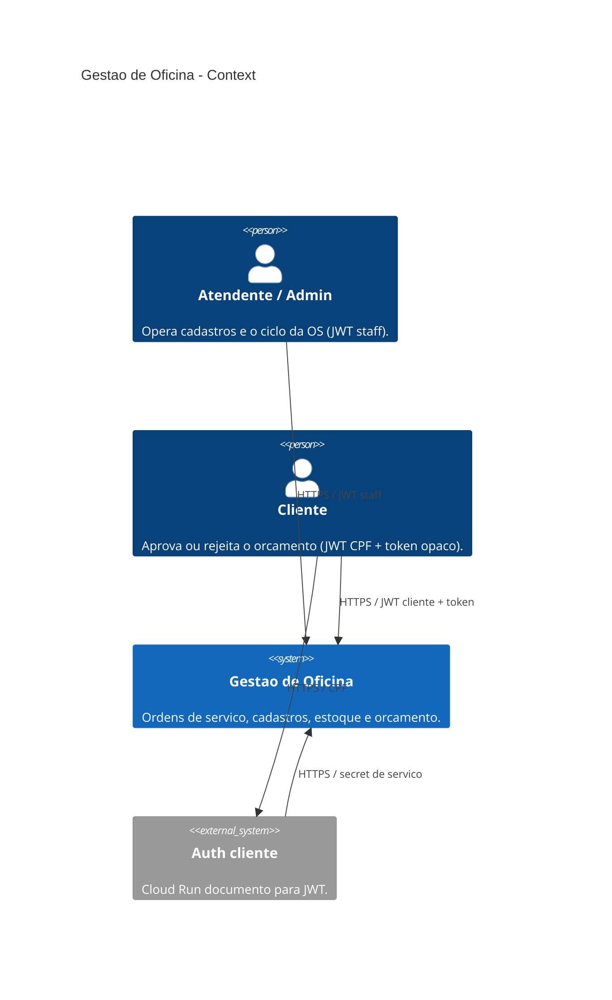
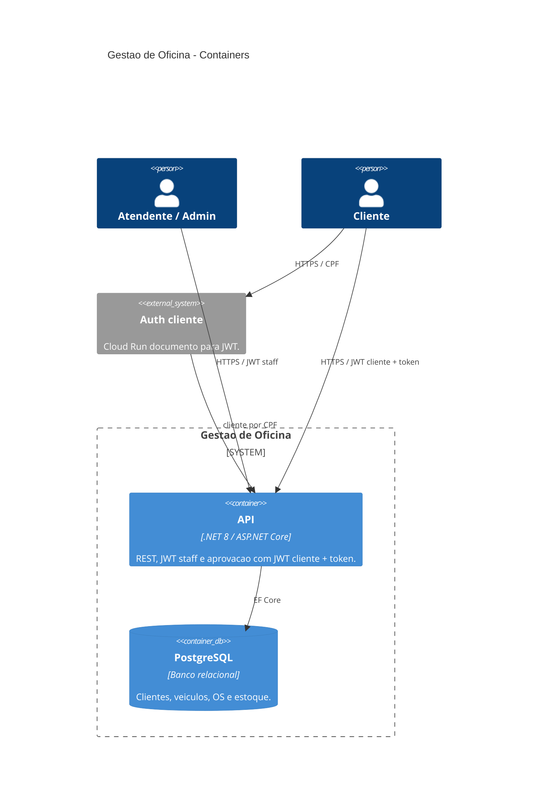
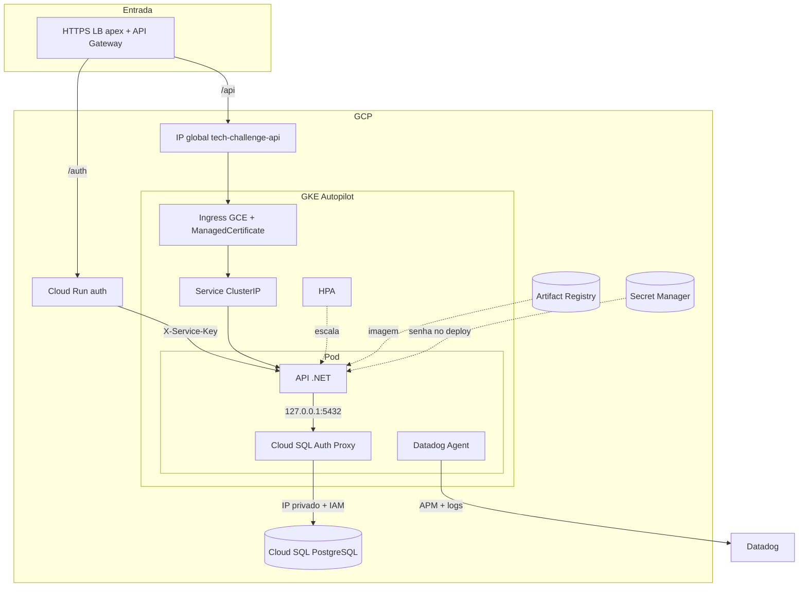
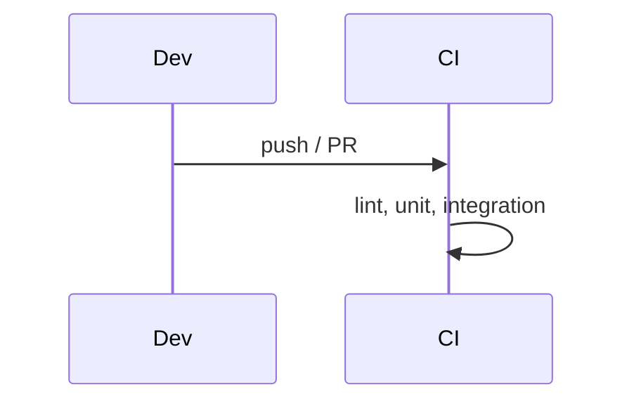

# Gestão de Oficina Mecânica

API .NET 8 para ordens de serviço, clientes, veículos, catálogo de serviços e estoque. Clean Architecture, PostgreSQL, Docker Compose para dev local e GKE Autopilot na GCP. Cluster e banco são provisionados pelos repos [`infra-k8s`](https://github.com/fiap-vcosta/infra-k8s) e [`infra-db`](https://github.com/fiap-vcosta/infra-db); os manifests e o deploy moram aqui.

## Arquitetura

### C4 — System Context



### C4 — Containers



Fluxo interno da API: `Controller` → `Use Case` → `Gateway` / `Domain` → `Presenter` → HTTP.

### Infraestrutura

Diagrama completo (Gateway, Cloud Run auth, stacks): README do [`infra-k8s`](https://github.com/fiap-vcosta/infra-k8s#componentes-nuvem). Visão focada no workload da API:



Modelo de dados (ER): [`docs/08_modelo-de-dados.md`](docs/08_modelo-de-dados.md). Sequência auth CPF: README do [`auth`](https://github.com/fiap-vcosta/auth).
### CI



---

## Como executar

### Docker Compose

```bash
cp .env.example .env
docker compose --profile app up -d --build
```

- API / Swagger / Health: http://localhost:8083 · `/swagger` · `/ordem-servico/health`
- JWT via JWKS/PEM do `autenticacao-service` (sem login local). Catálogo via `administrativo-service` (`Administrativo:BaseUrl` + `ServiceAuth:Key`).
- Variáveis: [`.env.example`](.env.example)

### SDK .NET

```bash
docker compose up -d
dotnet restore
dotnet ef database update --project src/Infrastructure --startup-project src/Api
dotnet run --project src/Api --launch-profile http
```

API local: http://localhost:5225

---

## Terraform (GCP)

Root module: [`terraform/`](terraform/). State GCS prefix `ordem-servico-service`. Lê a instância Cloud SQL do [`infra-db`](https://github.com/fiap-vcosta/infra-db) e a SA de runtime do [`infra-bootstrap`](https://github.com/fiap-vcosta/infra-bootstrap). Tópicos vêm do [`infra-events`](https://github.com/fiap-vcosta/infra-events).

| Recurso | Papel |
|---------|--------|
| Database `ordem_servico` | Banco do serviço |
| Role `ordem_servico_app` + `REVOKE CONNECT … FROM PUBLIC` | Isolamento cross-database |
| Usuário `ordem_servico` | Login da app com `database_roles = [ordem_servico_app]` |
| Secrets SM | `ordem-servico-service-connection-string` |
| Org secret | `SERVICE_AUTH_KEY` — shared secret da malha (`X-Service-Key` / `ServiceAuth__Key`) |
| Pub/Sub subscriptions + DLQ | Consome orçamento/estoque/pagamento (7 pull subs) |
| Pub/Sub publisher IAM | `diagnostico-finalizado`, `ordem-servico-aprovada\|finalizada\|descartada` |

`tf-apply` / `tf-destroy` são manuais.

## CD (GCP)

| Workflow | Gatilho | Papel |
|----------|---------|--------|
| `build-push` | push em `main` | Imagem `ordem-servico-service` no Artifact Registry |
| `tf-apply` / `tf-destroy` | `workflow_dispatch` | Database, usuário, role, secrets SM e subscriptions |
| `deploy` | `workflow_dispatch` | Secret k8s (connection string SM + org `SERVICE_AUTH_KEY`/`DD_API_KEY`) + manifests + smoke `/ordem-servico/health` |

Pré-requisitos do `deploy`: cluster/Gateway do [`infra-k8s`](https://github.com/fiap-vcosta/infra-k8s), `tf-apply` deste repo e imagem do `build-push`.

Manifests em [`k8s/`](k8s/): Deployment (Cloud SQL Proxy + Datadog), Service, HPA, KSA, HTTPRoute `/ordem-servico` e HealthCheckPolicy. O `HTTPRoute` expõe só o prefixo público; `/system/…` fica no cluster. JWT staff/cliente no ConfigMap valida JWKS em `https://vcosta-fiap.online/autenticacao/.well-known/jwks.json`. `Administrativo__BaseUrl` / `Estoque__BaseUrl` apontam para os Services do cluster.

Não há Job de migration: a app roda `db.Database.Migrate()` no start com o proxy já pronto.
---

## Observabilidade (Datadog)

APM e logs da API na janela da demo (RNF22/RNF23; ADR [`docs/adrs/001-datadog-apm.md`](docs/adrs/001-datadog-apm.md)).

| Peça | Como |
|------|------|
| Logs | Serilog JSON no console + sink HTTP Datadog quando `DD_API_KEY` existe (intake derivado de `DD_SITE`) |
| APM | `Datadog.Trace.Bundle` + Agent **sidecar** no Deployment |
| Status OS | Log Info `OS {id} movida para o status {Status}` nos handlers (widgets de log no dashboard) |
| `/health` | Continua **público** (probes e smoke) |

Secrets/vars (org ou repo):

| Nome | Tipo | Uso |
|------|------|-----|
| `DD_API_KEY` | Secret | Agent sidecar + sink de logs |
| `DD_SITE` | Variable (opcional) | Default `datadoghq.com` se omitida |

Na demo, com o stack no ar e tráfego (Requestly):

1. Datadog → **APM** → serviço `api` (`env:prod`) — traces e latência.
2. **Logs** — JSON com `RequestId`; abra um log e siga para o trace (`dd.trace_id`).
3. Dashboard deste serviço: importe [`docs/datadog/dashboard-service-demo.json`](docs/datadog/dashboard-service-demo.json) — passos em [`docs/datadog/README.md`](docs/datadog/README.md). Dashboard geral da Saga: repo `e2e` → `docs/datadog/`.
4. Monitores HTTP/health — mesmo doc (`notify_no_data: false`; mute após `demo-down`).

Compose local: JSON no console sempre; envio ao Datadog só se `DD_API_KEY` estiver no `.env` (sem sidecar local por padrão).

---

## APIs principais

| Capacidade | Endpoint | Auth |
|------------|----------|------|
| Abrir OS (veículo + serviços + peças) | `POST /api/ordens-servico` | JWT Admin |
| Consultar OS | `GET /api/ordens-servico/{id}` | JWT Admin |
| Listar OS ativas | `GET /api/ordens-servico` | JWT Admin |
| Aprovar / rejeitar orçamento | `POST …/ordens-servico/aprovar?token=` · `…/rejeitar?token=` | JWT **cliente** + token opaco |
| Cliente por CPF (serviço) | `GET /api/system/clientes/por-documento/{documento}` | `X-Service-Key` |

Listagem exclui Finalizada, Entregue e Descartada; ordenação por status evolutivo e data. Aprovação reutiliza os mesmos use cases da API autenticada; o CPF do JWT deve ser o do dono da OS. Requisitos: [`docs/01_requisitos.md`](docs/01_requisitos.md). Auth cliente: repo [`auth`](https://github.com/fiap-vcosta/auth).

---

## Testes e CI/CD

```bash
dotnet test tests/UnitTests/UnitTests.csproj
dotnet test tests/IntegrationTests/IntegrationTests.csproj   # requer Docker
./run-tests-with-coverage.sh                                 # meta ≥ 80%
```

- Estratégia: [`docs/06_testes.md`](docs/06_testes.md)
- Collections HTTP: [`docs/07_api.md`](docs/07_api.md) (Swagger + Requestly; e2e Gateway em `12-gateway-cliente-aprovar`)
- CI: `ci-dotnet` + `ci-terraform` via [`fiap-vcosta/actions`](https://github.com/fiap-vcosta/actions) ([`ci.yml`](.github/workflows/ci.yml))
- CD: `build-push` (merge `main`), `tf-apply` / `tf-destroy` / `deploy` manuais

---

## Documentação

Índice: [`docs/README.md`](docs/README.md)

| Repo | Papel | Diagrama / doc-chave |
|------|--------|----------------------|
| [`infra-bootstrap`](https://github.com/fiap-vcosta/infra-bootstrap) | Rede, WIF, AR, zona DNS | Persistente |
| [`infra-db`](https://github.com/fiap-vcosta/infra-db) | Cloud SQL | ADRs de banco |
| [`infra-k8s`](https://github.com/fiap-vcosta/infra-k8s) | GKE + Gateway + Cloud Run auth | [Componentes](https://github.com/fiap-vcosta/infra-k8s#componentes-nuvem) |
| [`api`](https://github.com/fiap-vcosta/api) | App + manifests + Requestly | [ER](docs/08_modelo-de-dados.md) · C4 (acima) |
| [`auth`](https://github.com/fiap-vcosta/auth) | Imagem documento → JWT | Sequência no README |